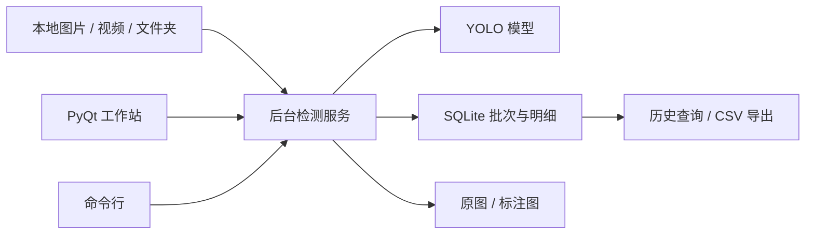

# 钢结构裂缝离线检测工作站 2.1.0

新手操作、模型指标、数据标注、继续训练及更换模型的说明见 [新手使用与模型训练指南.md](新手使用与模型训练指南.md)。

新增人工复核、历次复核记录和待标注样本包导出；具体操作和软著准备边界见 [软著准备与功能原创性说明.md](软著准备与功能原创性说明.md)。本次未修改模型权重或提升已测精度。

这是供现有 Windows/CPU 电脑试用的离线检测与结果追溯版本。支持单张图片、视频和文件夹批量检测，不连接 PLC/MES。检测结果是**辅助筛查**：`DEFECT` 表示模型发现疑似裂缝，`NO_DETECTION` 只表示当前参数下未检出，不能自动判定工件合格。模型仍是原项目的 40 轮 YOLOv8n 权重，原验证集最后一轮 mAP@50 约 0.545、召回率约 0.563；未取得现场工况验收数据。

此前在当前电脑使用真实权重对一张 512×512 验证集图片完成端到端验证，模型推理约 8.35 秒（不含模型首次加载）；该单张结果不能代表批量吞吐量。2.1.0 已通过设置插件路径后的无屏幕 Qt 历史/复核操作测试，正式试用前还应在目标桌面会话手动启动界面并走完一个批次。

## 启动

在项目目录打开 PowerShell。已配置的本机环境可用：

```powershell
.\.venv\Scripts\python.exe app.py
```

若之前启动过软件，更新代码后请先关闭旧窗口，再执行上面的命令。微信接收的图片请先“另存为”到固定文件夹，再在软件中选择该图片；微信的 `temp/RWTemp` 临时路径可能被清理，导致检测时找不到文件。

其他电脑先安装 Python 3.11–3.13、CPU 版 PyTorch 和 `requirements.txt` 中的包，再复制已训练的 `best.pt`，并在 [inspection_config.json](inspection_config.json) 中设置权重路径和结果目录。部署前固定并验证所用 Python、PyTorch、Ultralytics、OpenCV、NumPy、PyQt5 版本。`.pt` 文件会由 PyTorch 反序列化，只加载可信来源的模型；应用会记录文件 SHA-256，并在加载过程中验证未被替换。现场离线部署时可提前准备离线 wheel 包。

## 使用

1. 选择可信的本地模型、图片/视频或文件夹，填写批次/工件编号。
2. 根据现场验证的策略设置置信度阈值，点击“开始检测”。模型在后台运行；可按“停止”在当前帧保存后安全结束。
3. 在历史记录里按批次、复核状态筛选，查看图片和逐条坐标/置信度；可勾选“查看原图（便于复核）”。点击“导出 CSV”导出当前筛选的全部记录（不限于界面最近 200 条），包含最新复核结果。
4. 选择一条记录，填写复核人、整张图片的复核结论与依据，点击“保存人工复核”。机器预测保持不变，历次人工修改保留在详情的 `review_history` 中。处理失败项需重新检测，不能直接复核为无裂缝。
5. 点击“导出复核样本 ZIP”回收当前筛选中已复核记录及可用原图；缺少原图会明确计数。样本仍需人工修正、补画标注才能用于训练。

也可用命令行批量执行：

```powershell
.\.venv\Scripts\python.exe industrial.py inspect --source "图片或视频文件夹" --batch "工单-001"
.\.venv\Scripts\python.exe industrial.py history
.\.venv\Scripts\python.exe industrial.py export --file "检测记录.csv"
```

`--config` 可指定另一份配置。命令行还支持 `--weights`、`--conf`，`export --run-id` 可只导出指定批次。退出码：0 全部成功、2 存在处理失败项、130 用户停止、1 初始化/存储失败。

## 数据与维护

默认结果位于 `inspection_data/`：`inspections.sqlite3` 是索引及明细，每个批次 ID 文件夹存储原图和标注 PNG，`inspection.log` 是轮转日志。每条记录保存 UTC 时间、批次、源路径、源文件 SHA-256、视频帧编号、结果类别、框/轮廓及置信度、耗时和错误原因；每个批次保存模型 SHA-256、参数和运行环境版本。视频按配置的 `video_stride` 抽帧，源 SHA-256 指整个视频文件。输出目录不可包含输入目录，以免重复扫描。`save_images` 可设为 `all`、`defects`、`none`；默认为 `all`，有利于复核，但大批量视频会占用较多空间。

请定期备份**整个** `inspection_data/`，包括 SQLite 数据库和图片文件夹。运行期间不要手动删除其中的文件；停止检测后再做备份/归档。应用会在每帧保存前检查剩余磁盘空间，达到 `min_free_mb` 下限就停止并标记批次失败。断电/强制结束时可能留下 `RUNNING` 批次，历史页会显示该状态，不应当作完成。

## 现场验收前还需确定

- 确定最小可检裂缝尺寸、成像分辨率、光照、视角、工件表面类型和 ROI；建立独立现场测试集，覆盖正常、裂缝、划痕、焊缝、油污、反光等样本。
- 约定按**工件**计算的漏检率、误报率及置信区间，以及批次处理时限；依据测试集重新训练/校准模型阈值。
- 在目标电脑测量长时间运行稳定性、单图/视频吞吐量、磁盘增长和备份恢复；完成操作员复核流程和版本变更记录。

## 架构决定（ADR-001）

**背景：** 当前只需在单台 CPU 电脑上离线处理图片/视频，重点是记录可追溯。网络服务、消息队列和在线设备接口会提高部署及运维成本。

**决定：** 单机 PyQt 工作站通过后台线程调用 YOLO；同一服务可由命令行调用。每条检测在图片原子写入后写 SQLite 事务，批次保存模型哈希和配置。文件夹/视频逐项流式处理；错误项显式入库，存储故障中止批次。

**权衡：** 无网络依赖、易部署和查询；单机 SQLite 不适合多台电脑并发共享写入，视频保存全部帧将显著占用磁盘。后续若接 PLC/MES，应在明确协议和验收条件后增加独立接口，不直接改动追溯记录结构。


