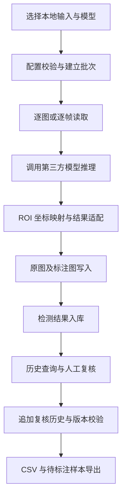

# 工业裂缝检测离线版 V1.0 软件设计说明

本说明依据现有业务源码整理，覆盖从输入到结果回收的完整流程。它是当前实现说明，不是原始开发日志，不用于证明所有技术由申请人首创。

## 1. 业务需求与范围

目标是在单机上读取本地图片、视频或文件夹，调用已准备好的裂缝模型，保存结果并支持复核。为后续追查，应知道某次结果对应哪个批次、源文件、模型及参数；为收集训练资料，应保留人工意见和原图。

本版本不含网络平台、设备控制、用户权限系统、逐框标注工具或自动再训练。依赖的目标检测算法、张量计算、编解码与 GUI 库由第三方提供。

## 2. 系统组成与文件映射

| 业务层 | 源文件 | 职责 |
| --- | --- | --- |
| 启动 | `app.py`、`industrial.py` | 分别启动桌面程序与命令行 |
| 版本 | `industrial_crack/__init__.py` | 记录程序内部版本 |
| 配置 | `industrial_crack/config.py` | 校验阈值、尺寸、ROI、保存策略等并解析路径 |
| 界面 | `industrial_crack/gui.py` | 输入选择、任务线程、预览、查询、复核和导出操作 |
| 检测任务 | `industrial_crack/service.py` | 枚举输入、读帧、调用模型、坐标还原、保存与回调 |
| 存储 | `industrial_crack/storage.py` | 批次、结果、复核历史持久化及 CSV 导出 |
| 样本回收 | `industrial_crack/review.py` | 一致性快照、复核分歧分类、原图与元数据导出 |
| 命令行服务 | `industrial_crack/cli.py` | 参数解析、进度输出、日志与服务复用 |

## 3. 核心处理流程

### 3.1 输入与批次建立

启动时读取 JSON 配置；相对路径按配置所在目录解析。选择输入后检查路径、批次和本地模型存在性。输入与输出目录相互包含时拒绝执行。推理前计算模型文件 SHA-256，并写入批次、配置和运行环境。

加载模型后再次计算其 SHA-256，检查加载期间文件未发生变化。适配器限制检测或分割任务，且类别只能是 `crack`。这些校验并不证明模型来源可信或精度合格。

### 3.2 推理与坐标还原

图片按字节读取后解码，兼容中文路径。视频逐帧读取并按步长处理；内存不累积全部视频帧。指定 ROI 时对局部矩形进行推理，将预测框和可用轮廓的坐标加上 ROI 偏移，统一转换回原图坐标。

预测结果适配为类别、类别名、置信度、框坐标及可选轮廓。绘制标注图依赖第三方模型结果绘制能力。无预测返回 `NO_DETECTION`，有预测返回 `DEFECT`，不直接作产品合格判定。

### 3.3 后台任务与停止

界面使用工作线程调用同一检测服务，通过信号回传预览和统计；预览更新限制为每秒最多约五次。停止使用协作事件，当前帧处理与持久化结束后退出。程序不强制终止线程。

运行状态含 `RUNNING`、`COMPLETED`、`COMPLETED_WITH_ERRORS`、`CANCELLED`、`FAILED`。文件解码等输入错误作为失败项记录；存储故障中止批次，避免界面声称结果已成功保存。

## 4. 数据设计

数据库为 SQLite，连接启用 WAL、外键检查及 FULL 同步。每个工作线程使用自己的连接。三个主要实体如下：

| 表 | 主键及关联 | 主要内容 |
| --- | --- | --- |
| `runs` | `id` | 批次名、起止时间、状态、模型指纹、配置、环境和错误 |
| `inspections` | `id`，`run_id` 关联批次 | 源路径、视频帧号、源指纹、机器结果、预测 JSON、耗时、图片相对路径和错误 |
| `reviews` | 自增 `id`，`inspection_id` 关联结果 | 时间、复核人、整图结论和依据 |

图片先写同目录临时文件、刷新并原子替换，再插入检测结果。单条结果保存失败时清理本次生成图片。批次和每条图片之间没有跨文件系统/数据库的分布式事务；强制断电仍需检查残留状态。

时间统一以 UTC 保存，界面历史列明确标示 UTC。图像源指纹对应原始文件字节；视频记录保存视频文件指纹和帧号。导出 PNG 指纹描述导出的图像字节，不能与源视频指纹混淆。

## 5. 人工复核规则

未存在复核记录时查询结果显示 `PENDING`。提交必须填写复核人、依据和有效结论；失败检测项不允许直接复核。结论为 `CONFIRMED`、`CLEAR` 或 `UNCERTAIN`，分别对应整图有裂缝、无裂缝和需复查。

系统不修改机器预测，每次复核追加新行。提交在事务中读取当前最大复核 ID，与用户看到的版本比较：不相同则拒绝，提示刷新。最新意见用于列表与 CSV，全部历史用于详情与样本包。

复核人是手工姓名而非认证身份；数据库有文件权限者仍可直接修改。追加历史和 SHA-256 不等于电子签名、防篡改认证或司法证据认证。

## 6. 导出设计

CSV 使用 UTF-8 BOM，按批次和复核状态筛选，对可能解释为公式的文本转义。先写临时文件，成功后替换目标文件。

样本 ZIP 在 SQLite 读快照中读取最新结果和全部复核历史，排除未复核记录。对整图人机判断分类为疑似漏检、疑似误报、需复查或判断一致。分类不是逐框评价指标。

原图仅从配置的结果根目录内读取，越界路径拒绝；缺失原图明确统计。复制图像时计算 SHA-256，包内同时保留预测、批次参数和复核历史。没有生成训练标签或自动训练功能。

## 7. 可说明的业务实现与限制

可说明的实现包括离线任务状态管理、原图坐标统一、批次与模型/输入证据关联、人机双结果存储、复核版本控制以及待标注样本回收。其使用的事务、哈希、版本比较等是通用技术；YOLO、SE/CBAM 等不是本项目原创算法。

依赖层面的许可见业务源码中的第三方声明。后续模型精度提升应单独准备实验与独立测试集，本次整理未训练模型，也未验证现场性能。
